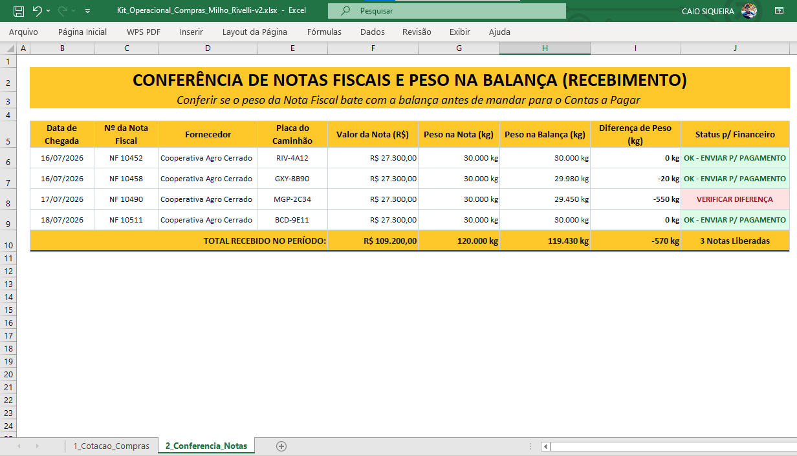
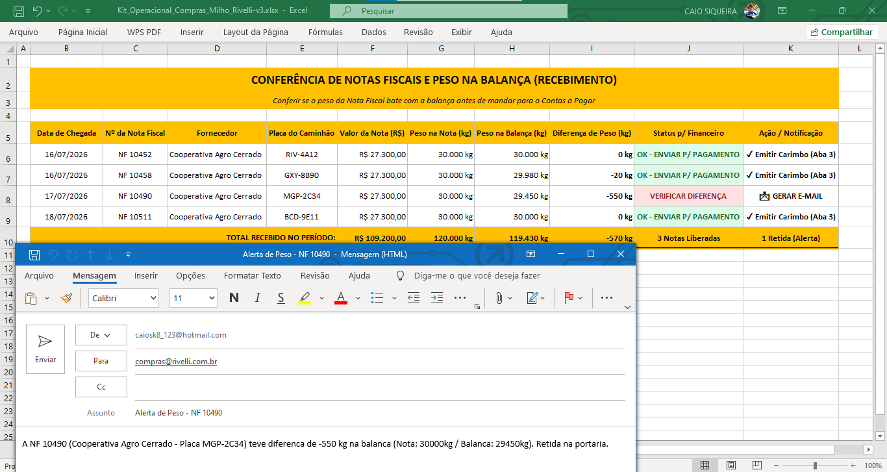
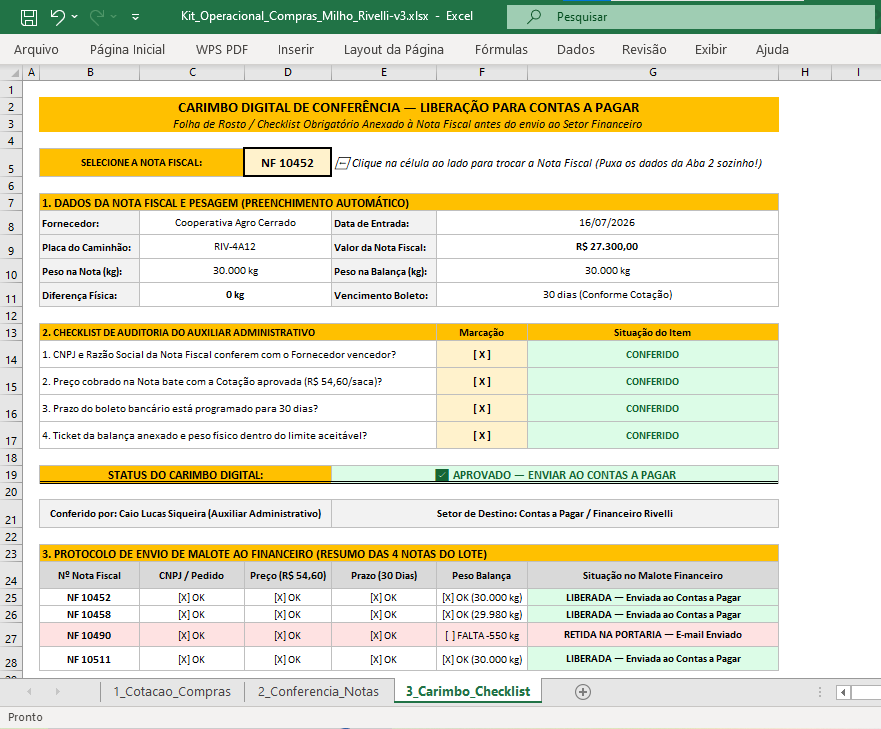

# 📊 Administrativo Rivelli — Kit Operacional de Suprimentos & Recebimento (Agroindústria Avícola)

> **Simulação Prática de Rotinas Administrativas Aplicadas ao Setor de Compras, Recebimento Físico e Portaria**
>
> **Autor:** Caio Lucas Siqueira | Estudante do 2.º Período de Administração e 6.º Período de Engenharia de Software.
>
> **Identidade Visual:** Inspirada na paleta institucional (Rivelli / Cadeia de Grãos)

---

## 🎯 Sobre o Projeto

Este repositório apresenta um **Kit Operacional Administrativo** ([`Operacional_Compras_Milho_Rivelli.xlsx`](Operacional_Compras_Milho_Rivelli.xlsx)) desenvolvido para demonstrar a aplicação prática de conceitos de gestão de suprimentos, controle de custos e portaria em uma agroindústria avícola.

O projeto resolve dois grandes gargalos do dia a dia de um **Auxiliar Administrativo**:

1. **Evitar compras antieconômicas** através da comparação estruturada de fornecedores de milho (matéria-prima principal da ração).
2. **Blindar o financeiro contra perdas** cruzando o peso físico da balança rodoviária com a Nota Fiscal de entrada (*Three-Way Match*).

---

## 📂 Estrutura do Kit (Abas Funcionais)

O projeto está contido em uma única ferramenta integrada em Excel ([`Operacional_Compras_Milho_Rivelli.xlsx`](Operacional_Compras_Milho_Rivelli.xlsx)), dividida em 3 abas funcionais:

### 1️⃣ Aba `1_Cotacao_Compras` (Mapa de Cotações)

* **Objetivo:** Registrar e comparar o orçamento de 3 fornecedores diferentes de milho em grãos.
* **Mecânica:** O auxiliar insere o preço da saca (60 kg) e o frete por saca. A planilha calcula automaticamente o **Preço Final c/ Frete**, o valor total do lote (ex: 1.000 sacas) e destaca visualmente o **Melhor Preço** para fechamento do pedido.
* **Gráfico Integrado:** Visualização rápida em barras para tomada de decisão gerencial.

---

### 2️⃣ Aba `2_Conferencia_Notas` (Portaria e Balança)

* **Objetivo:** Fazer o batimento físico e fiscal das cargas de grãos que chegam à fábrica.
* **Mecânica:** Registra a Nota Fiscal, o peso faturado e o peso real aferido na balança da empresa.
* **Automação Inteligente:**
  * Se o peso estiver correto $\rightarrow$ Status **Verde (`OK - ENVIAR P/ PAGAMENTO`)**.
  * Se houver divergência de quebra de transporte acima do aceitável (ex: a `NF 10490` com **-550 kg** faltantes) $\rightarrow$ Status **Vermelho (`VERIFICAR DIFERENÇA`)**.
  * **Botão de E-mail Automático:** Um atalho nativo em fórmula (`HIPERLINK`) que gera instantaneamente a ocorrência formatada para envio aos departamentos de Compras e Financeiro.

#### ✉️ Disparo Automático de Ocorrência (Divergência de Balança)

---

### 3️⃣ Aba `3_Carimbo_Checklist` (Folha de Rosto / Contas a Pagar)

* **Objetivo:** Simular o carimbo físico que o auxiliar administrativo anexa na Nota Fiscal antes de encaminhá-la para o Contas a Pagar.
* **Mecânica:** Um seletor de notas onde o gestor visualiza os 4 critérios essenciais de *compliance*:
  1. `[X]` CNPJ e Razão Social conferem com o pedido.
  2. `[X]` Preço cobrado bate com a cotação aprovada.
  3. `[X]` Prazo do boleto configurado para 30 dias (proteção de capital de giro).
  4. `[X]` Ticket de balança anexado e peso aprovado.
* **Bloqueio Automático:** Notas com divergência exibem o selo `⛔ BLOQUEADO — RETER NOTA E COBRAR FORNECEDOR`.

---

## 💡 Competências Administrativas Demonstradas

* **Gestão de Compras & Compliance:** Aplicação da regra de múltiplos orçamentos e composição de custo logístico (Frete CIF/FOB).
* **Controladoria & Prevenção de Perdas:** Identificação rigorosa de quebras de carga e retenção de documentos fiscais indevidos.
* **Comunicação Corporativa:** Redação de e-mails de ocorrência claros, objetivos e com proposição de soluções (abatimento de duplicata).
* **Domínio de Ferramentas (Excel):** Uso de funções lógicas (`SE`), formatação condicional, gráficos dinâmicos e hiperlinks inteligentes.

---

## 🔗 Série Completa — Trilogia & Portfólio de Dados Rivelli

1. 🚢 **[Inteligência de Exportação de Aves (MG)](https://github.com/Caiolsiqueira/inteligencia-exportacao-aves-mg)** — Dinâmica cambial, Comex Stat e competitividade internacional.
2. 🌽 **[Inteligência de Custos e Margem na Avicultura](https://github.com/Caiolsiqueira/inteligencia-custos-margem-avicultura)** — Ração (Milho/Soja), relação de troca e compressão de margem.
3. 🥩 **[Inteligência de Varejo e Elasticidade Cruzada](https://github.com/Caiolsiqueira/inteligencia-varejo-elasticidade-avicultura)** — Efeito substituição Boi Gordo vs. Frango Resfriado (CEPEA 2016–2025).
4. 📋 **Administrativo Rivelli (Este Repositório)** — Kit operacional de compras de grãos, conferência física/fiscal de balança e compliance no Contas a Pagar.

---
*Repositório criado para fins de portfólio profissional e demonstração de competências em rotinas administrativas, suprimentos e controle financeiro.*
